# 020 基于 Django 的新闻舆情分析系统-设计展示

> **代码有偿获取 可接受定制 微信联系方式: csbysj2020 或 ACE2487，备注(BS)**

> **完整源码与全套文档 · 在线自助获取 >>> [https://mbd.pub/o/bread/YZaWlZZyaQ==](https://mbd.pub/o/bread/YZaWlZZyaQ==)**

> **成品页（功能介绍 / 更多选题）>>> [https://bishe.suilang.net/products/django-news-opinion](https://bishe.suilang.net/products/django-news-opinion)**

> 

> 

## 视频

> **点击查看 >>> [https://www.bilibili.com/video/BV1oS4b61Ek9/](https://www.bilibili.com/video/BV1oS4b61Ek9/)**

## 项目简介

面向新闻标题的舆情分析系统：真实采集中国新闻网、人民网、新华网 725 条公开标题，清洗后 232 条入库，完成情感判定、TF-IDF 关键词、KMeans 热点聚类与舆情预警，并在 20 条人工抽检中如实报告模型偏差（三分类一致率 60%、负面召回 100%）。第 20 套「杂志特稿风」界面。

新闻标题是成本最低、覆盖面较广的舆情信号。

本项目设计并实现了一套新闻舆情分析系统，真实采集中国新闻网滚动新闻与频道页、人民网 RSS、新华网 RSS 的公开标题与发布时间，清洗后得到 2026-11-04 至 11-05 共 232 条有效标题，覆盖 8 个频道。

系统完成情感判定（SnowNLP，三段阈值）、关键词抽取（jieba TF-IDF）、热点聚类（TF-IDF + KMeans，8 簇）与舆情预警，并以 9 个页面呈现。

本仓库为**设计展示**：包含项目说明、技术架构、实验结果与运行截图；完整源码、任务书、开题报告、毕业论文与使用说明可通过上方链接自助获取，成品页可查看更多选题，也可联系微信咨询定制。

## 功能特性

1. 真实采集：中国新闻网滚动分页 + 国内/社会频道页 + 人民网/新华网 RSS，共 725 条标题；只取标题/链接/时间等元数据，不抓正文

2. 清洗与批次过滤：按 URL 去重、剔除过短与异常标题、过滤人民网 RSS 的 2025-06 旧缓存批次，避免时间轴断裂；最终 232 条、2 天窗口如实标注

3. 情感判定：SnowNLP 打分 0~1，三段阈值；20 条人工抽检得出三分类一致率 60%、负面召回 100%、精确率 50%——模型对真负面敏感，却把中性陈述判为正面

4. 关键词：jieba TF-IDF 每篇抽 5 词，汇总 TOP30，并统计每个关键词的负面率与峰值日期

5. 热点聚类：TF-IDF + KMeans 聚 8 簇，过滤单字与符号后取权重词作簇名（新疆/服务、博会/第九届等），每簇附代表标题

6. 预警：负面占比 ≥25% 记一条、每日高频词取前三且 ≥5 次；因窗口仅 2 天，弃用不稳定的「7 日移动基线」，规则改动本身写进论文

7. 9 个页面 + 原始 CSV 下载 + Django admin，ECharts 本地内置离线可用；第 20 套杂志特稿风（纯白 + 墨黑大字 + 克莱因蓝）

8. 论文实验可复现：所有数字来自 data/analysis/findings.json，重跑 import_news 自动更新

## 技术架构

| 项目 | 说明 |
| --- | --- |
| 编程语言 | Python 3.8 及以上 |
| 后端框架 | Django 4.2 |
| 数据采集 | requests 抓中新网滚动/频道页 + RSS 解析（低频、只取元数据） |
| 文本分析 | jieba 0.42（分词/TF-IDF）、SnowNLP（情感）、scikit-learn 1.3（TF-IDF + KMeans） |
| 数据库 | MySQL 8.0（交付默认 SQLite，免安装） |
| 可视化 | ECharts 5（已内置本地文件，离线可用） |
| 数据规模 | 原始 725 条 / 清洗后 232 条 / 8 频道 / 2 天 / 8 话题 |
| 操作系统 | Windows / macOS / Linux |
| 启动方式 | 双击一键脚本，或 python manage.py runserver 8085 |

## 目录结构

以下为完整交付版的结构（本仓库仅作设计展示）：

```
django-news-opinion/
├── 任务书/
│   └── 毕业设计任务书.docx
├── 开题报告/
│   └── 毕业设计开题报告.docx
├── 最终论文/
│   ├── 图/
│   │   ├── 图3-1_系统用例图.png
│   │   ├── 图4-1_系统架构图.png
│   │   ├── 图4-2_功能模块图.png
│   │   ├── 图4-3_数据处理与质控流程图.png
│   │   └── 图4-4_数据库ER图.png
│   └── 基于Django的新闻舆情分析系统设计.docx
├── 源码/
│   ├── crawler/
│   │   └── fetch_news.py
│   ├── data/
│   │   ├── analysis/
│   │   └── raw/
│   ├── newsscope/
│   │   ├── __init__.py
│   │   ├── settings.py
│   │   ├── urls.py
│   │   └── wsgi.py
│   ├── opinion/
│   │   ├── management/
│   │   ├── migrations/
│   │   ├── __init__.py
│   │   ├── admin.py
│   │   ├── apps.py
│   │   ├── models.py
│   │   ├── urls.py
│   │   └── views.py
│   ├── static/
│   │   ├── css/
│   │   ├── vendor/
│   │   └── favicon.svg
│   ├── templates/
│   │   ├── alerts.html
│   │   ├── base.html
│   │   ├── channels.html
│   │   ├── dashboard.html
│   │   ├── keywords.html
│   │   └── …
│   └── …
└── …
```

## 数据与实验结论

- 通过 20 条人工抽检发现：三分类一致率仅 60%，但负面类的召回率为 100%、精确率为 50%——模型对真正的负面事件敏感，却容易把中性陈述判为正面。
- 同时，公开源滚动页窗口有限、RSS 存在旧缓存，不同批次混排会让时间轴断裂，系统按年份清洗并如实标注实际覆盖天数，而不是把 2 天数据包装成长期趋势。
- 真实采集：中国新闻网滚动分页 + 国内/社会频道页 + 人民网/新华网 RSS，共 725 条标题；只取标题/链接/时间等元数据，不抓正文
- 清洗与批次过滤：按 URL 去重、剔除过短与异常标题、过滤人民网 RSS 的 2025-06 旧缓存批次，避免时间轴断裂；最终 232 条、2 天窗口如实标注

## 交付内容

1. 完整源码（Django 工程 + 真实采集脚本 + 情感/关键词/聚类/预警导入命令）
2. 原始新闻标题 CSV 与演示数据库、findings.json 实验产物
3. 毕业设计任务书（Word）
4. 毕业设计开题报告（Word）
5. 毕业论文（Word，七章制，含人工抽检与模型偏差分析）
6. 系统使用与二次开发说明（Word + md）
7. 系统运行截图 11 张

## 常见问题

**数据是真实采集的吗？**

是。从中国新闻网滚动页与频道页、人民网 RSS、新华网 RSS 采集公开标题与发布时间，共 725 条，原始 CSV 随包可下载。只取标题/链接/时间等元数据，不抓正文。

**为什么只有 232 条、2 天？**

公开滚动页只保留最近约 10 页；人民网 RSS 返回的是 2025-06 的旧缓存批次，与 2026-11 不在同一舆情窗口，混排会让时间轴断裂，因此在导入时按年份过滤。系统设计为可重复采集，持续运行即可累积时序。

**情感判定准吗？**

不完全准，论文里如实报告了：20 条人工抽检的三分类一致率 60%，负面召回 100%、精确率 50%。模型对坠机、袭击、事故这类真负面很敏感，但会把天气、赛果、会议等中性陈述判为正面。系统只把它用于趋势参考，页面明示「不代表事实判断」。

**为什么负面率不能用来给频道排名？**

社会频道天然多事故类标题，负面率高不代表报道倾向负面。页面只做相对差异提示，并在说明里写清这一点。

**热点话题是怎么来的？**

对全部标题做 TF-IDF 向量化后用 KMeans 聚 8 簇，每簇取权重最高的词作簇名，并过滤单字与符号。簇名不够自然，定位是「分组找线索」，不是给话题下定义。

**预警规则是什么？**

负面占比 ≥25% 记一条；每日高频词取前 3 且出现 ≥5 次。因为窗口只有 2 天，前 7 日移动基线不稳定，所以改用绝对阈值，这个取舍本身写进了论文 6.4。

## 截图

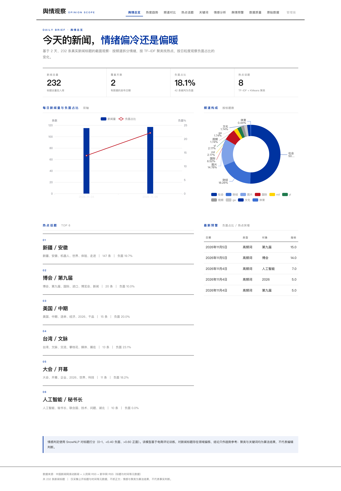
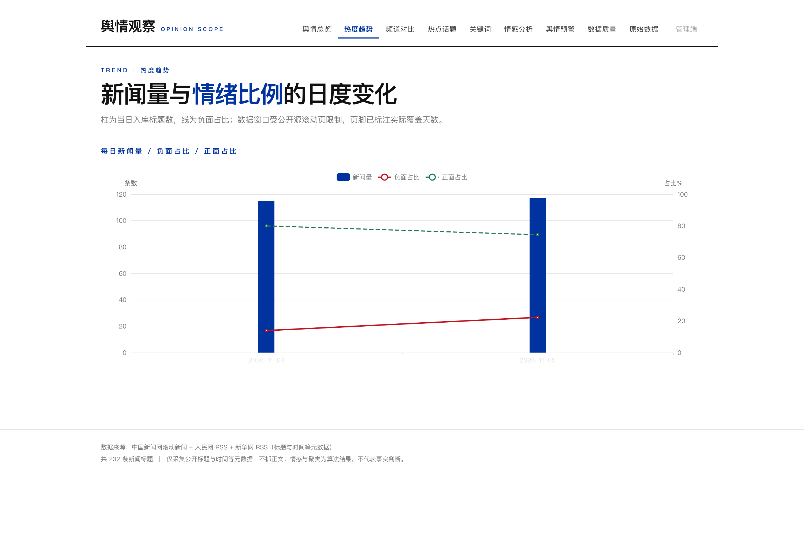
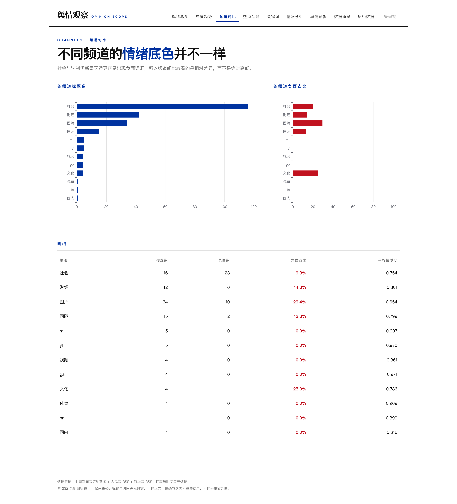
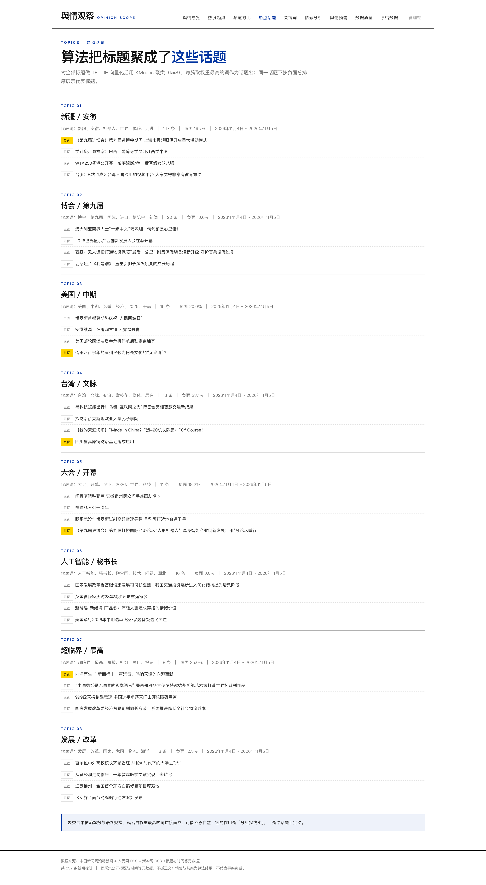
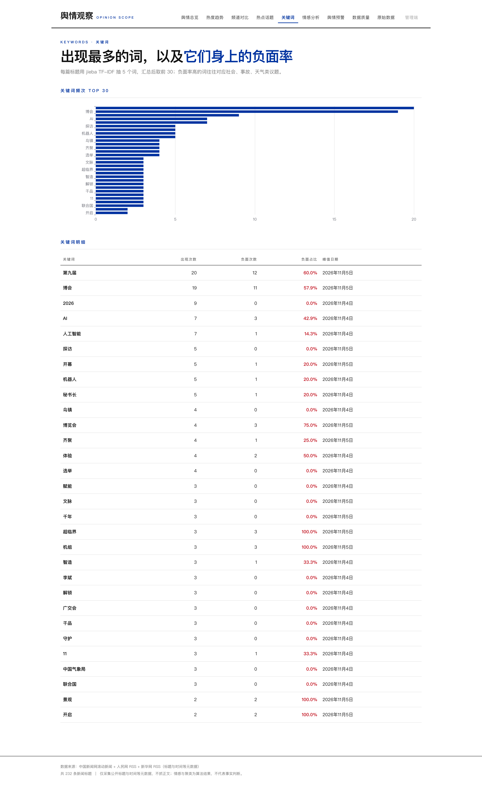
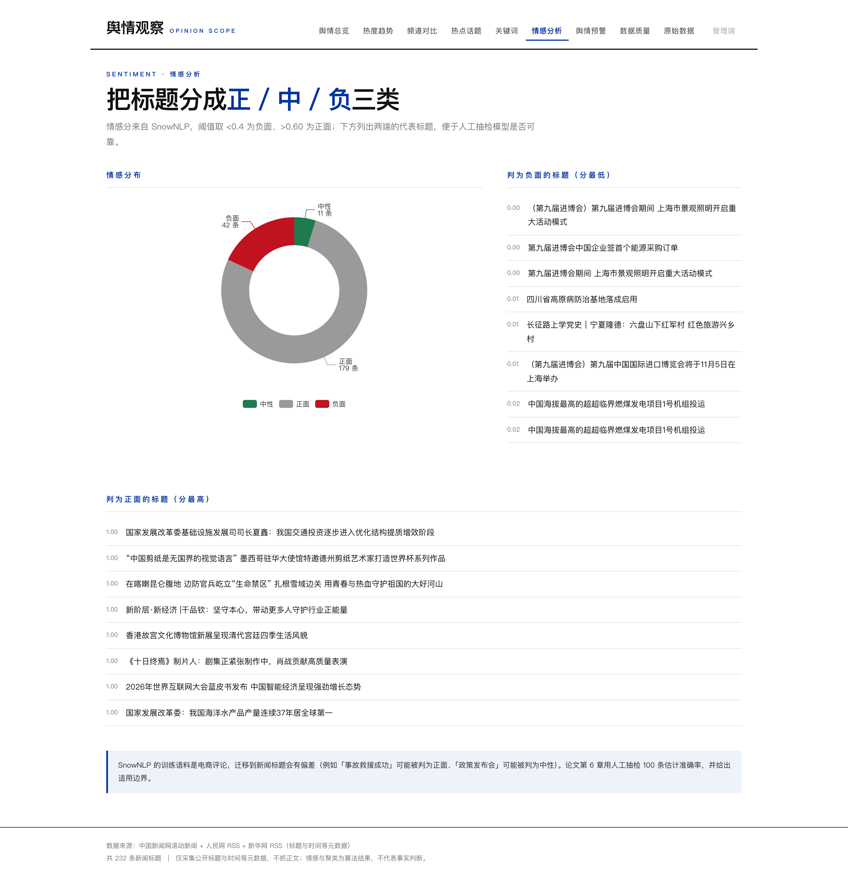
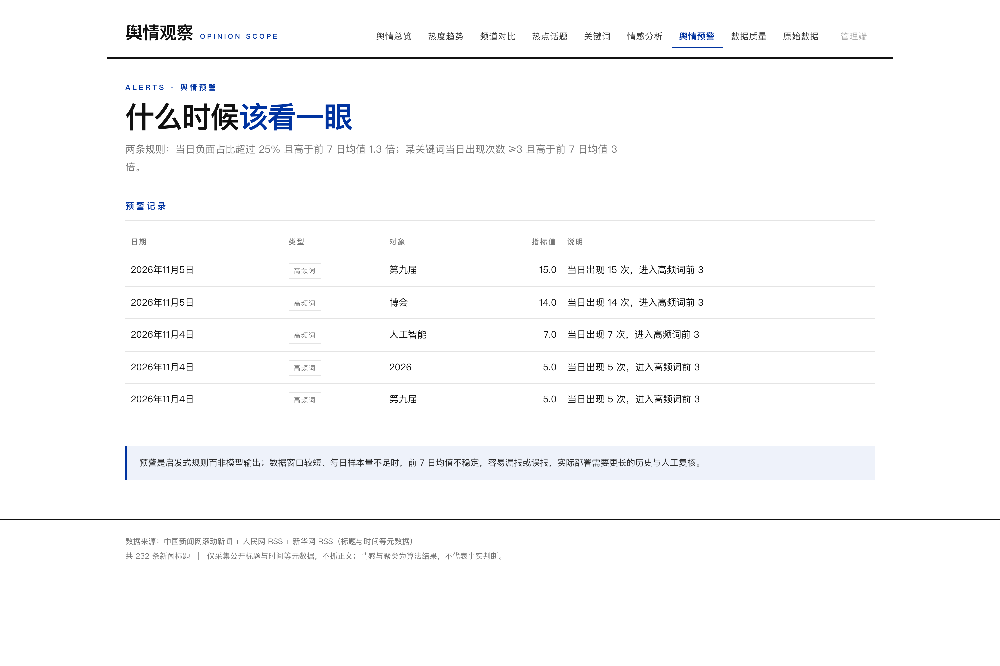
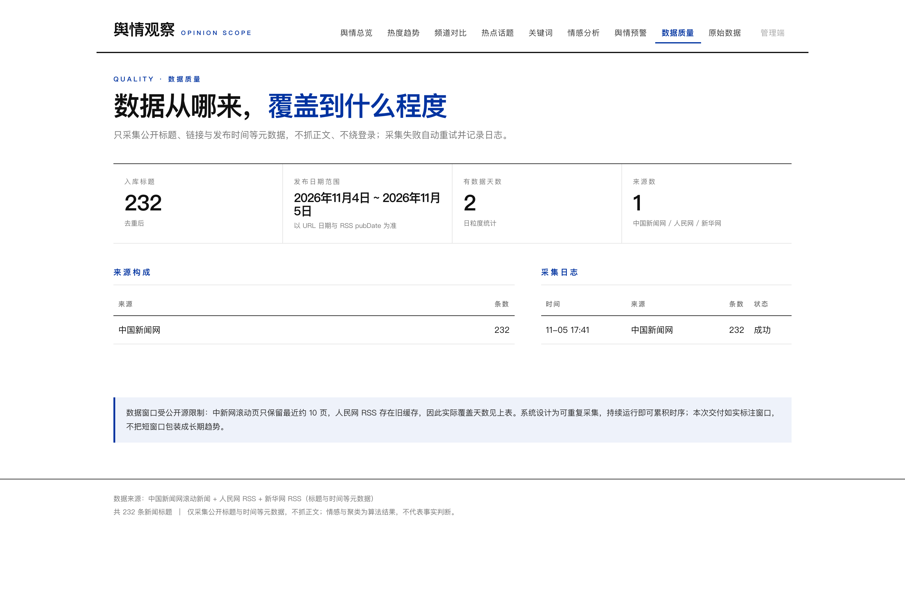
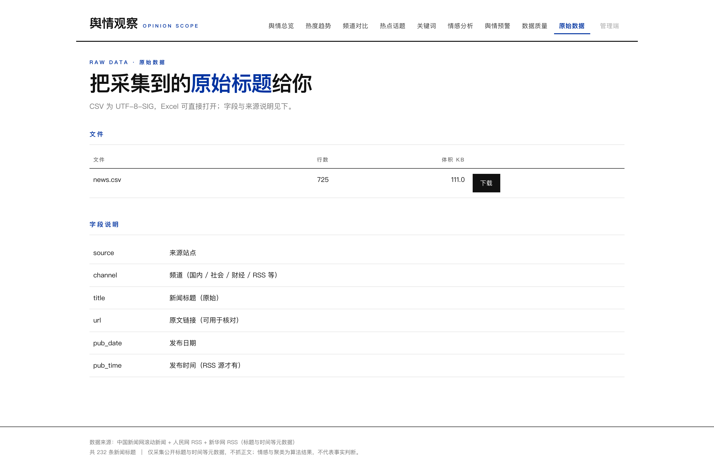
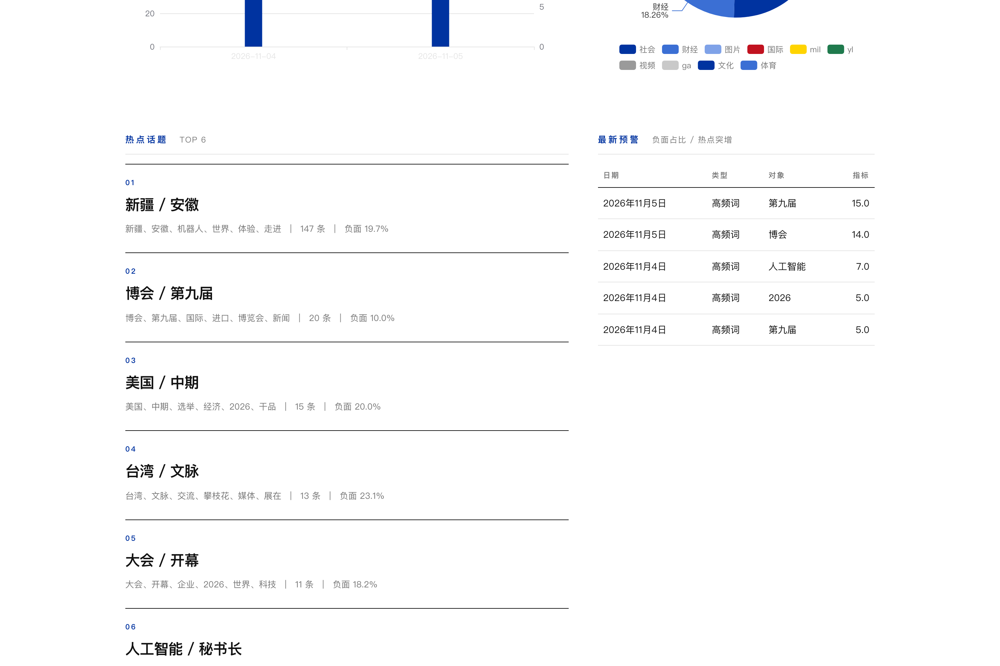
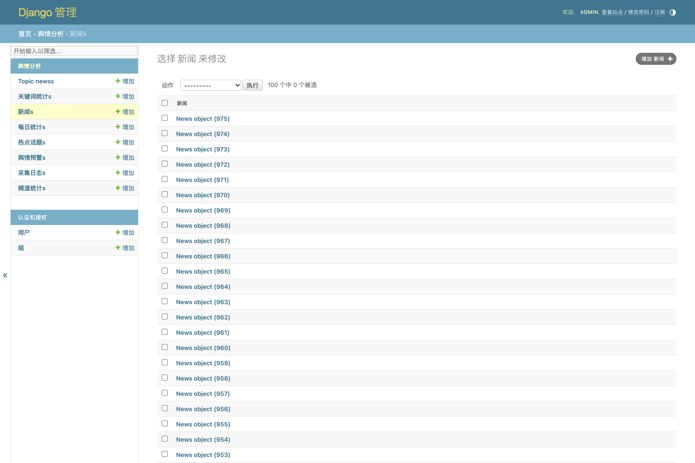
